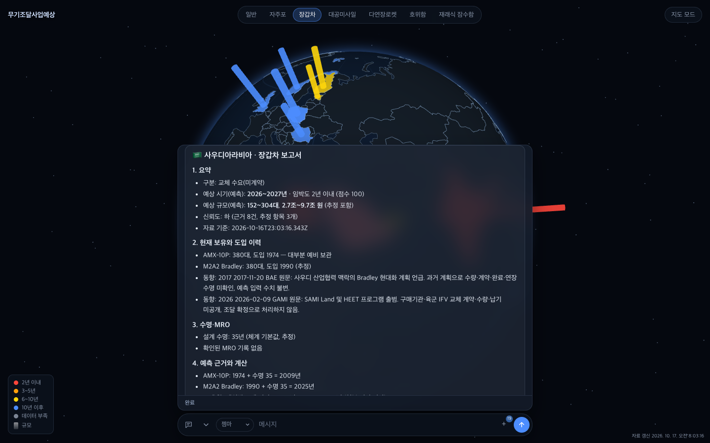
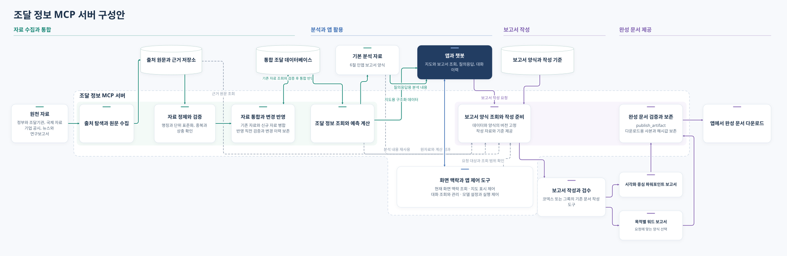

# HORUS

국가별 무기 보유 현황과 공개된 조달 계획을 바탕으로 장비 교체 수요를 살펴보는 앱입니다. 지도에서 교체 시기와 예상 규모를 비교하고, 채팅으로 자료를 조사해 데이터를 갱신하거나 보고서를 작성할 수 있습니다.



## 주요 기능

### 지도에서 교체 수요 확인

3D 지구본과 2D 지도에서 국가별 교체 시기, 수량, 예상 사업 금액을 비교합니다. 무기체계를 선택하고 국가를 누르면 현재 주력 장비, 설계 수명, 교체 예상 시기, 예상 사업 규모, 신뢰도와 출처를 국가 정보 카드로 확인할 수 있습니다. 자주포, 장갑차, 대공미사일, 다연장로켓, 호위함, 재래식 잠수함을 지원합니다. 수치는 공개 자료와 장비의 도입 연도, 설계 수명, 정비 이력을 바탕으로 계산한 예측 범위입니다.

상단 중앙의 무기 탭으로 체계를 선택합니다. 일반 탭은 자체 자료와 수주 판단 점수가 있는 무기 중 국가별 최고점 무기의 색을 표시합니다. 수출 제외·점수 미확인 국가는 바탕색을 유지하며, 최고점 무기와 점수는 국가 카드에서 확인합니다. 동점은 고정된 탭 순서로 정합니다. 화면 제목과 브랜드는 HORUS이며 `public/logo.png`를 사용합니다. 정보 카드의 판단 점수에 커서를 올리거나 누르면 항목별 점수를 볼 수 있습니다.

무기체계별 색은 고정하고 교체 예상 시기를 3년 이내·10년 이내·10년 이후로 나눠 각각 100%·50%·20% 밝기로 표시합니다. 시기 미확인은 같은 색의 35% 밝기로 표시하고 카드에 명시합니다. 자료 없는 국가 중 같은 무기체계의 자체 자료가 있는 육상 인접국이 하나 이상인 경우만 한 방향 빗금으로 표시합니다. 나머지는 바탕색입니다. 빗금은 경위도에 고정돼 지구 회전·확대·평면 이동과 함께 움직이며 교차 무늬는 사용하지 않습니다.

인접국 참고 점수는 자료가 일부인 인접국도 포함하고 자료 없는 국가·해상 인접국·중복 국경은 제외합니다. 후보 국가끼리 인접국 수와 예상 사업 금액 합계의 중간값을 각각 최대값으로 나눠 50점씩 합산합니다. 미확인 금액은 더하지 않으며 후보가 아닌 국가는 점수 평가 대상에서 제외합니다. 동점은 금액·인접국 수·국가 코드 순으로 정하고 순위는 카드에서만 표시합니다. 이는 주변국 참고 표시이며 해당 국가의 보유 장비나 사업 금액을 추정해 생성하지 않습니다.

사업 금액은 현재 화면의 국가별 최대값으로 정규화한 뒤 `log(1 + 9 × 비율) / log(10)`을 적용합니다. 3D에서는 막대 높이, 2D에서는 일정한 두께의 원 지름으로 비교합니다. 미확인 금액은 그래프를 만들지 않습니다. 2D 지도는 날짜변경선을 넘어 좌우로 이어지고 반복된 지도에서도 국가를 선택할 수 있습니다. 최대 줌아웃과 세로 이동은 북위·남위 90도를 기준으로 제한합니다. 별 배경은 3D에서 밝게, 국경선은 두껍게 표시합니다.

### 공개 자료 조사와 데이터 갱신

그록 빌드, 코덱스, 지피티, 네모트론으로 조사를 요청할 수 있습니다. 모델이 사용할 수 있는 검색 도구로 자료를 찾고 원문과 출처를 보존한 뒤, 검증을 거쳐 데이터와 예측을 갱신합니다. 화면에서 보고 있던 국가와 보고서를 대화에 활용하고, 첨부 자료를 함께 검토하거나 같은 대화에서 모델을 바꿔 작업할 수 있습니다.

채팅에서 **“독일을 추가해줘”**, **“브라질과 튀르키예를 등록해줘”**처럼 국가를 추가할 수 있습니다. 앱 지도에 있는 177개 국가·지역의 한국어·영문 이름과 국가 코드를 인식하고 국가명·국기·지도 위치를 등록한 뒤, 기본적으로 운영 DB의 전체 무기체계에서 부족한 보유·도입·사업 자료를 조사합니다. 이미 등록된 국가도 누락을 보완하고 기존 자료는 유지합니다. **“국가명만 등록하고 조사는 하지 마”**라고 하면 국가 등록으로 끝냅니다. **“브라질 자주포만 보완해줘”**처럼 범위를 지정할 수도 있습니다. 목록에서 찾을 수 없는 이름은 정확한 표기를 확인합니다.

보유 수량이 미공개여도 확인된 장비명과 도입 연도를 보존합니다. 도입 연도와 기본 설계 수명으로 교체 시기만 추정할 수 있고, 수량·금액은 미확인으로 표시합니다. 퇴역·도입 예정 장비는 현역에서 제외합니다. 사업 설명만 저장된 체계는 조사 완료로 보지 않으며 체계별 누락과 미공개·접근 실패 이유를 알립니다.

### 사업기회 판단 점수

국가·무기체계별 사업기회를 100점 만점으로 계산합니다. 계산은 `shared/forecast.ts`의 `computeScore`에 있습니다.

| 요소 | 배점 | 계산 근거 |
|---|---|---|
| 도입 의사 표명 | 20 | 최근 3년(2023~2026) 또는 예상 시기가 2026년 이후인 신호의 최고 단계. 검토 5, 입찰 15, 선정 대기 20점 |
| 노후화 | 20 | 가장 빠른 퇴역 예상 연도(70%)와 10년 내 교체 대상 보유 비율(30%). 보유 이력이 없으면 기존 교체 예측 사용 |
| 재정 여력 | 15 | 국방비 최근 3년 평균 증가율(60%)과 GDP 대비 국방비 비중(40%) |
| 주변국 압력 | 15 | 인접국별 긴장도 × (최근 3년 같은 체계 구매 50% + 국방비 증가율 50%) 중 최댓값 |
| 경쟁 우위 | 15 | 그룹사 최근 5년 수주, 이 나라의 경쟁사 수주, 그룹사와 경쟁사 납기 비교 |
| 소모 보충 | 10 | 소모·공여량 대비 재고(70%)와 기존 공급사 수주잔고 기준 납기(30%) |
| 접근성 | 5 | 한국산 장비 운용 1.0, 방산 협정만 있으면 0.6 |

각 요소 점수는 배점 × 원점수(0~1) × 출처 신뢰도입니다. 신뢰도는 공식 발표·DB 1.0, 전문 매체 0.7, 일반 뉴스·X 0.4이고, 추정한 인도 연도는 근거가 있으면 ×0.7, 기본값이면 ×0.4를 곱합니다. 자료가 없는 요소는 0점으로 처리하고 정보 카드에 없는 자료를 표시합니다.

합계에는 수출 등급 계수(수출 가능 1.0, 조건부 수출 가능 0.7)와 독자 개발 중 계수(0.8)를 곱합니다. 수출 불가 국가와 같은 체계를 독자 양산하는 국가는 0점으로 제외합니다. 배점과 계수는 DB의 `weights` 테이블에서 조정할 수 있습니다.

### 상세 보고서 작성

상세 조사가 필요하면 인공지능 에이전트를 통해 워드나 파워포인트 보고서를 작성할 수 있습니다.

## 전체 흐름



자료조사부터 정제·검증·반영, 예측·점수 계산, 보고서 작성까지의 단계별 흐름은 [자료조사-보고서 흐름도](docs/자료조사-보고서-흐름.svg)에 있습니다.

## 설치와 실행

Node.js 22.16 이상의 22.x 또는 24 이상, Git, Supabase 프로젝트를 준비합니다. 앱은 내 컴퓨터의 Node.js 서버에서 실행하고 데이터와 파일은 Supabase에 보관합니다.

### 1. 코드 받기

```sh
git clone --branch "무기조달사업예상" --single-branch https://github.com/chongyun821-pixel/TrendRadar.git
cd TrendRadar
npm install
```

### 2. Supabase 연결 설정

프로젝트 폴더의 `.secrets.example`을 `.secrets`라는 이름으로 복사합니다.

```sh
cp .secrets.example .secrets
```

Windows PowerShell에서는 `Copy-Item .secrets.example .secrets`를 사용합니다.

`.secrets`를 열어 다음 값을 입력합니다.

```dotenv
SUPABASE_URL=
SUPABASE_SECRET_KEY=
DATABASE_URL=
SUPABASE_STORAGE_BUCKET=trendradar-private
```

Supabase 대시보드에서 프로젝트 URL과 서버용 Secret API key를 가져옵니다. `DATABASE_URL`에는 Connect의 Transaction pooler 연결 주소(포트 6543)를 입력하고, 비밀번호 자리를 프로젝트 DB 비밀번호로 바꿉니다. 비밀번호에 특수문자가 있으면 URL 인코딩해야 합니다.

### 3. 채팅 모델 준비

사용할 모델 하나를 준비하면 됩니다.

| 모델 | 준비할 것 |
| --- | --- |
| 그록 빌드 | Grok Build CLI 설치와 로그인 |
| 코덱스 | Codex CLI 설치와 로그인 |
| 지피티 | `.secrets`에 `OPENAI_API_KEY` 입력(기본 `gpt-5.4-mini`, `OPENAI_MODEL`로 변경) |
| 네모트론 | `.secrets`에 `OPENROUTER_API_KEY` 입력 |

네모트론은 `nvidia/nemotron-3-super-120b-a12b:free`를 먼저 사용하고, 호출이 실패하면 OpenRouter의 `openrouter/free`로 전환해 요청에 맞는 무료 모델을 자동 선택합니다. 응답에는 실제 사용한 모델을 기록합니다. 키 인증 오류와 사용자가 중지한 요청은 대체 호출하지 않으며, 무료 모델 호출까지 실패하면 오류를 표시합니다.

OpenAI 키가 있으면 지피티가 기본 모델이고, 없으면 쓸 수 있는 첫 모델을 고릅니다. 지피티와 네모트론에 Firecrawl을 연결하려면 `FIRECRAWL_API_KEY`도 입력합니다. 지도 조회와 국가별 예측 확인은 모델 인증 없이 사용할 수 있습니다.

### 4. 데이터 준비 후 실행

Supabase 연결을 확인하고 초기 자료를 가져옵니다.

```sh
npm run supabase -- check
npm run supabase -- migrate
```

이전 결과에 `"verified": true`가 나오면 앱을 실행합니다.

```sh
npm run dev
```

브라우저에서 [http://localhost:62356](http://localhost:62356)을 엽니다. 종료할 때는 터미널에서 Ctrl+C를 누릅니다.

빌드한 화면으로 실행하려면 `npm run build` 후 `npm run serve`를 사용합니다. 설정을 바꾼 뒤에는 서버를 다시 시작하세요.

### 5. 공개 자료 수집(선택)

판단 점수에 쓰는 SIPRI·World Bank·UCDP·GDELT·Oryx 자료는 수집 테이블을 만든 뒤 적재합니다. 인증키는 필요 없습니다.

```sh
npm run supabase -- schema
npm run ingest:all -- --dry-run
npm run ingest:all
```

출처별 명령과 옵션은 [데이터 수집 실행 안내](docs/data-collection.md)를 참고하세요.

## 처음 사용하기

1. 상단에서 살펴볼 무기체계를 선택합니다.
2. 지도에서 국가를 눌러 국가 정보 카드의 장비 현황과 교체 예측, 출처를 확인합니다.
3. 입력창에 `/models`로 모델(코덱스·그록 빌드는 세부 모델과 추론 강도까지)을 고르고 조사할 내용을 입력합니다. 지난 대화 열기·새 대화·삭제는 `/sessions`에서 합니다. `/`만 입력하면 명령 후보가 뜨고 Tab으로 완성합니다. 입력창 위 대화 제목을 누르면 바로 고칠 수 있고, 모델 이름을 누르면 모델 선택이 열립니다.

예를 들어 다음과 같이 요청할 수 있습니다.

> 폴란드 자주포의 최근 조달 계획을 공식 자료로 확인하고, 기존 데이터와 달라진 내용과 근거를 알려줘.

첨부 자료는 입력창의 `＋`에서 추가합니다. 조사 결과를 파일로 정리하고 싶다면 Word나 PowerPoint 작성을 요청하고, 완성된 파일을 채팅이나 자료 메뉴에서 내려받으면 됩니다.

## 주의사항

- SIPRI는 공식 API·인증키가 없어 사이트(비공식 백엔드) 형식이 바뀌면 수집이 끊길 수 있습니다.
- World Bank API는 느리거나 시간 초과가 날 수 있습니다(재시도 후 실패 시 다시 실행).
- UCDP API는 토큰이 필요해 공개 CSV를 씁니다.
- GDELT는 달마다 4일만 받아 환산한 표본값입니다.
- Oryx는 웹 페이지를 읽어 오므로 페이지 구조가 바뀌면 깨질 수 있습니다.
- ITAR 126.1 목록은 eCFR 대신 Cornell LII 사본에서 읽습니다.
- 체계별 미국산 부품 여부는 아직 미확인입니다.
- 보유 현황은 인도 기록 누적으로 만든 추정치입니다.
- 이집트·중국은 수기 지정으로 수출 불가입니다(`data/reference/export-controls.json`).
