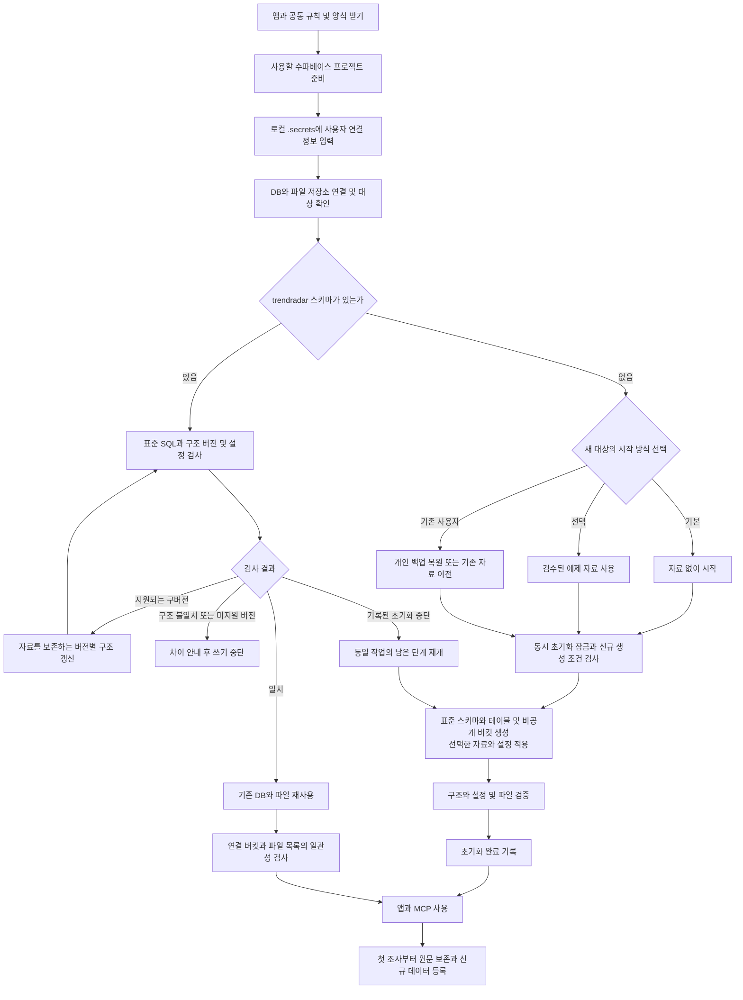

# 조달 정보 MCP 서버 구현 과제

갱신일: 2026-10-22

## 지도 색상·자료 충실도·인접국 참고 표시 (2026-10-22)

- [x] 흰색에 가까웠던 지도 채움을 기둥과 같은 원색 중심으로 강화했다. 흰색 대신 어두운 지도 바탕에 혼합하고, 먼 시기의 색 비중을 34%→60%, 자료 일부 표시의 색 유지 비율을 38%→70%로 높였다. 시기·자료 충실도 구분과 회색·빗금 조건은 유지한다.
- [x] 무기체계별 고정 색과 임박도별 농도를 분리했다. 수량·사업 금액은 색 농도를 바꾸지 않으며 막대 높이로 표시하고, 미확인 금액은 막대를 만들지 않는다. 점수·수출 제외 사유는 국가 카드에서 유지한다.
- [x] 실제 장비·시기·수량·출처 누락과 낮은 신뢰도는 같은 색을 연하게, 시기 미확인은 연한 회색으로 표시한다. 자료 없는 국가는 같은 체계의 자료 충분 국가가 육상 국경으로 2개 이상 직접 인접할 때만 빗금을 표시한다. 중복 국경, 해상 인접, 자료 일부 및 빗금 국가의 재전파는 제외한다.
- [x] 지구본·평면 지도에서 국경 안에만 빗금을 그리고, 범례와 국가 카드에 의미와 참고 인접국을 명시한다. 빗금으로 보유 장비·교체 예측이나 데이터베이스 기록을 생성하지 않는다.
- [x] 전체 테스트 177개와 빌드가 통과했다. `npm run map:check`는 자동 격리 SQLite·Chrome에서 실제 픽셀의 빗금/단색 차이, 점수 제외와 색상의 분리, 모드별 색·막대, 시기·자료 부족 카드, 일반 모드 복귀, PC·모바일의 범례·카드·입력창 배치를 검증한다. 운영 데이터와 모델은 호출하지 않는다.

## 국가 추가 후 보유·교체 자료 공백 수정 (2026-10-22)

- [x] 사업 설명만 저장되고 `batches`가 비어 있던 원인과 지도 필드의 연결을 확인했다. 보유 수량·도입 연도를 nullable로 보존하고, 확인된 연도만으로 시기를 추정하되 미확인 수량·금액은 null로 반환한다. 현재 주력과 가장 오래된 교체 대상, 퇴역·도입 예정 장비를 구분한다.
- [x] 국가 추가 시 기본적으로 지원 체계의 누락 자료를 조사하고 `get_country_data_status`로 실제 지도 필드를 검사한다. 과거 인도 이력은 조사 문맥으로 제공하며 현재 보유량으로 자동 합산하지 않는다. `save_equipment`는 원문 파일·해시·인용문을 검증한 뒤 서버가 동일한 정제·검증·변경/예측 저장 절차를 수행한다. 복합 양식 오류에는 실제 출처 메타데이터와 수정 예시를 반환한다. 첨부 문서 뷰어만 있는 페이지의 메뉴를 원문으로 저장하지 않는다.
- [x] 사용자 요청에 따라 운영 DB의 대한민국 6개 체계에 공개 원문 근거와 초기 도입·인도 기준 자료를 보강했다. 수량은 미확인으로 유지했고, 초기 도입분 기준의 수명 추정이 전체 배치의 확정 교체 일정이 아님을 기록했다. 기존 사업 설명·근거와 변경 이력은 보존했다.
- [x] 격리 SQLite에서 PC·모바일의 수량 미확인/연도 미확인 표시와 가로 넘침, 콘솔 오류를 검증했다. 별도 PostgreSQL 스키마·비공개 버킷에서 실제 GPT가 복합 조사 도구와 간단한 장비 도구로 각각 K21 도입 이력·시기·미확인 수량을 저장하는 흐름을 확인했다. 독립 SQL·새 저장소·지도 API·전체 응답 보존을 대조하고 임시 검증 리소스를 정리했다. 다른 모델의 실제 호출과 비공개 수량의 추가 확보는 검증 완료로 표시하지 않는다.

## 챗봇 국가 추가 (2026-10-22)

- [x] 공통 `find_country`·`add_country` 도구로 채팅과 MCP에서 국가 등록을 지원한다. 지도와 같은 177개 국가·지역의 한국어·영문 이름과 코드를 해석하고 이름·국기·지도 위치, 변경 이력과 데이터 버전을 함께 저장한다. 기존 국가와 조사 자료는 보존하고 중복 요청과 중지 시 롤백을 검증했다.
- [x] 신규 국가의 조사 준비와 정제에서도 이름·코드와 국가 메타데이터를 해석한다. 등록만으로 빈 보유 수량이나 예측을 만들지 않으며, 조사를 요청한 경우 기존 원문 보존·검증·반영 흐름을 이어간다.
- [x] 전체 테스트 160개와 빌드가 통과했다. 실제 MCP 전송과 채팅 API의 가상 모델 응답을 검증했다. 별도 PostgreSQL 스키마·비공개 버킷에서 실제 GPT가 독일·브라질을 등록하고, 독립 SQL 연결과 새 저장소 및 지도 API에서 데이터와 전체 응답 저장을 확인했다. 검증 리소스는 정리했고 운영 데이터에는 검증 국가를 추가하지 않았다. 실제 다른 모델의 호출과 지도 목록 밖의 소국 지원은 이번 검증 범위에 포함하지 않았다.

## CLI 작업 폴더 수정 (2026-10-22)

- [x] 다른 PC에서 만든 빈 대화를 DB에서 불러올 때 CLI 작업 폴더가 없어 `spawn node.exe ENOENT`로 실패하던 문제를 수정했다. `prepareWorkspace`는 원격 복원 파일의 유무와 관계없이 기본 작업 폴더부터 준비한다.
- [x] 폴더가 없는 대화에서 실제 Node 자식 실행, 격리 앱의 실제 Codex 응답과 MCP 도구 호출 및 응답 저장을 확인했다. 실제 Supabase의 새 로컬 캐시에서도 빈 대화의 CLI 실행이 가능함을 확인했다.

## 화면 제어 수정 (2026-10-22)

- [x] 같은 실행의 무기체계 변경과 국가 선택이 앞선 적용 버전을 이어받도록 수정했다. 연속 접수도 순서대로 처리하며 명시한 버전과 사용자 변경의 충돌 보호를 유지한다.
- [x] 국가 보고서를 저장한 뒤 실행 중에도 국가·체계 선택과 본문 표시를 명령으로 수행하고 실제 적용을 확인한다. 화면 상태와 적용 확인을 함께 저장하고, 보고서 로딩 중이나 최종 응답 표시 때 사용자 변경을 덮어쓰지 않는다.
- [x] 격리 SQLite·Chrome에서 폴란드 다연장로켓, 연속 제어, 사용자 변경 충돌, 실행 중 보고서, 데스크톱·모바일 표시를 검증했다. `npm run screen:check`로 재검증한다. 실제 모델별 전체 흐름 검증은 아래 남은 범위를 유지한다.

[MCP 서버 구성 도식](output/MCP_서버_재구성_도식.md)과 [구성안 이미지](outputs/MCP_서버_재구성_도식.png)를 기준으로 용어와 흐름을 정리한다. 실제 도구의 호출 방법은 [도구 사용 안내](docs/mcp-tools.md)를 따른다. 체크한 항목은 구현하거나 확인한 내용이며, 체크하지 않은 항목은 앞으로 할 작업이다. 설계 도식만으로 구현 완료를 판단하지 않는다.

다음 작업은 **출처 탐색과 원문 수집**, **자료 정제와 통합**, **보고서 양식 제작**을 중심으로 진행한다. 새로 배포받은 사용자도 같은 흐름을 이용할 수 있도록 **수파베이스 초기화**를 함께 설계한다. 담당자는 파일 구성과 세부 구현 방식을 제안하되, 단계 사이의 공통 정보와 완료 조건을 맞춘다.

## 용어와 전체 흐름

**조달 정보 MCP 서버**는 인공지능이 호출할 도구들을 제공하는 연결 창구다. 개별 도구는 출처 탐색이나 지도 제어처럼 특정 기능을 실행한다. 앱과 MCP 서버는 같은 검증과 저장 기능을 사용하며, 운영 데이터는 수파베이스 PostgreSQL, 파일은 비공개 저장소에 보존한다.

```mermaid
flowchart LR
  SOURCE["원천 자료"] --> COLLECT["출처 탐색과 원문 수집"]
  COLLECT --> EVIDENCE[("출처 원문과 근거 저장소")]
  EVIDENCE --> NORMALIZE["자료 정제와 검증"]
  NORMALIZE --> APPLY["자료 통합과 변경 반영"]
  DATA[("통합 조달 데이터베이스")] -->|"기존 자료와 버전 조회"| APPLY
  APPLY -->|"검증한 변경과 이력 저장"| DATA
  DATA --> ANALYSIS["조달 정보 조회와 예측 계산"]
  ANALYSIS --> BASE["기본 분석 자료<br/>기존 6절 구성"]
  ANALYSIS -->|"지도용 구조화 데이터"| APP["앱과 챗봇"]
  BASE -->|"질의응답용 분석 내용"| APP
  APP <-->|"요청 당시 상태와 최신 상태 구분"| CONTEXT["화면 맥락과 앱 제어 도구"]
  APP -->|"보고서 작성 요청"| PREPARE["보고서 양식 조회와 작성 준비"]
  TEMPLATE[("보고서 양식과 작성 기준")] --> PREPARE
  CONTEXT -.->|"요청 대상과 범위 확인"| PREPARE
  EVIDENCE -.->|"근거 원문"| PREPARE
  ANALYSIS -.->|"원자료와 계산 결과"| PREPARE
  BASE -.->|"분석 내용 재사용"| PREPARE
  PREPARE -->|"대상과 버전을 고정한 작성 자료"| AUTHOR["보고서 작성과 검수<br/>기존 문서 작성 도구"]
  AUTHOR --> PPT["시각화 중심 파워포인트 보고서"]
  AUTHOR --> WORD["목적별 워드 보고서"]
  PPT --> PUBLISH["완성 문서 검증과 보존"]
  WORD --> PUBLISH
  PUBLISH --> DOWNLOAD["앱에서 완성 문서 다운로드"]
```

> 외부 도구 참고: 출처 탐색과 원문 수집에는 Firecrawl MCP와 에이전트의 기본 웹 도구 및 MCP 연결도 함께 사용한다. 그록의 XSearch와 기존 명령줄 도구의 인증 및 설정을 유지한다. 수집 경로가 달라도 근거는 공통 형식으로 보존한다.

**자료 정제**는 명칭과 단위 및 사업 단계를 맞추는 작업이다. **검증**은 범위와 근거, 중복과 상충 및 변경 조건을 확인하는 작업이다. **자료 통합과 변경 반영**은 검증한 자료를 기존 기록과 병합해 저장하는 작업이다. **기본 분석 자료**는 앱과 문서가 함께 참고하는 내용이고, **보고서 양식**은 문서의 구성과 배치 및 서식을 정한 파일이다.

지도에는 구조화된 수치를 제공한다. 지도에서 표시하는 국가 정보 카드, 채팅에 생성하는 기존 6절 국가 보고서, 워드와 파워포인트 완성 문서를 구분한다.

## 현재 구현과 남은 범위

| 도식의 단계 | 현재 도구와 구현 | 남은 작업 |
| --- | --- | --- |
| 출처 탐색과 원문 수집 | `research_procurement`로 조사 준비, `search_sources`로 GOV.UK와 보존 출처 검색, `collect_source`와 `save_source`로 원문 보존, `read_source`로 재조회 | 국가별 수집 경로 확대와 출처 확인 기준 연결 |
| 자료 정제와 검증 | `normalize_procurement_data`로 기본 정제와 병합안 작성, `validate_research`로 형식과 인용 및 버전 검사 | 별칭과 단위 및 통화 기준 고도화, 실제 중복과 상충 사례 처리 |
| 자료 통합과 변경 반영 | `apply_research`에서 최종 검증, 기존 자료와 병합, 변경 전후 이력과 예측을 함께 저장 | 다양한 사업 관계와 부분 실패 사례 검증 |
| 조달 정보 조회와 예측 계산 | `query_procurement`, `calculate_forecast`, `get_country_analysis`와 기존 6절 국가 보고서 | 새 자료와 계산 결과 및 분석 내용의 일관성 검수 |
| 화면 맥락과 앱 제어 도구 | 요청 당시 필터와 국가 및 보고서 보존, 지도 명령과 적용 확인, 대화 관리와 모델 선택, 실행 중지 및 대화별 대기열 | 복수 호스트 환경과 모델별 전체 흐름 검증 |
| 보고서 양식 조회와 작성 준비 | `get_report_template`의 기본 양식 정의 3종, `prepare_report`의 대상과 데이터 및 가정과 양식 버전 고정 | 실제 양식 파일과 작성 지침 및 완성 예시 제작 |
| 완성 문서 검증과 보존 | `publish_artifact`의 워드와 파워포인트 파일 구조 검사, 검수 기록 연결, 사본과 해시값 및 다운로드 보존 | 새 양식으로 실제 문서를 작성하고 내용과 배치까지 검수 |
| 수파베이스 저장 구조 확인과 초기화 | 연결 확인, 기본 SQL 구조 생성, 기존 자료 이전, 전체 백업과 빈 대상 복구 명령 제공 | 표준 구조와 버전을 확인한 기존 대상 재사용, 대상이 없을 때 신규 생성, 첫 사용 안내 |

현재 `search_programs`는 저장된 사업 정보를 조회하는 기존 도구다. 외부 출처 탐색은 `search_sources`에 연결하며, 도구 이름만으로 외부 API 수집이 구현됐다고 보지 않는다. 기존 호출 이름과 원문 보존, 작업 파일 관리, 가정 변경 및 조사 이력 조회 기능은 유지한다.

## 우선 과제 1. 출처 탐색과 원문 수집

현재 운영 범위는 15개국의 59개 기록과 6개 무기체계다. 국가는 폴란드, 루마니아, 노르웨이, 핀란드, 에스토니아, 영국, 호주, 인도, 베트남, 필리핀, 인도네시아, 사우디아라비아, 아랍에미리트, 이집트, 캐나다다. 무기체계는 자주포, 장갑차, 대공미사일, 다연장로켓, 호위함, 재래식 잠수함이며, 일반 탭은 별도 무기체계가 아니다.

- [x] 추가 인증키 없이 사용할 수 있는 공개 검색과 원문 수집의 기본 도구를 제공한다. 원본 바이트와 추출문 및 해시값, 검색 요약과 원문, 결과 없음과 접근 실패를 구분한다.
- [ ] 위 국가와 무기체계의 정보를 실제로 찾을 수 있는 정부와 조달기관, 국제 자료, 기업 공시와 제조사 자료, 뉴스와 연구보고서를 찾아 수집 경로를 연결한다. 출처 목록에 주소만 적는 것으로 완료하지 않는다.
- [ ] 출처별 검색 조건과 조회 범위, 반환 항목, 원문 접근 방법 및 자료 기간을 확인하고 `search_sources`에 연결한다. 추가 API 키가 없는 경로를 우선하고 키가 필요한 연결은 후속 항목으로 구분한다.
- [ ] 국가와 무기체계별 출처 확인 기준을 만든다. 다른 국가나 군 조직, 다른 장비 또는 수출 제안에 관한 자료인지 원문으로 확인하고 발표와 승인, 계약 및 실제 인도를 구분한다.
- [ ] 출처 주소와 식별자, 발행일과 수집일, 자료 종류, 수집 경로, 원문과 추출문 보존 위치 및 해시값을 공통 형식으로 전달한다. 확인할 수 없는 발행일을 임의로 채우지 않는다.
- [ ] 접근 제한과 시간 초과, 본문 추출 실패 및 결과 없음을 구분하고 대체 경로와 재시도 기준을 정한다. 실패한 자료와 검색 요약을 확인된 원문 근거로 사용하지 않는다.
- [ ] 같은 주소의 변경본과 다른 경로에서 받은 동일 원문을 식별한다. 기존 원문을 덮어쓰지 않고 새 내용과 수집 이력을 연결한다.
- [ ] 대표 출처마다 검색부터 원문 보존과 재조회까지 실제 실행 예시를 제공한다. 수집 경로별 정상 결과와 결과 없음 및 접근 실패를 검증하고 전체 15개국 범위의 수집 가능 여부를 표시한다.

완료 기준은 **실행 가능한 수집 기능, 확인 기준, 실제 보존 원문과 재조회 결과**다. 최초 이관 출처의 원문과 수치에 대한 전수 재확인은 별도 미완료 작업으로 유지한다.

## 우선 과제 2. 자료 정제와 통합

- [x] 기본 명칭과 수량 및 사업 단계 정제, 기존 기록과의 병합, 상충 반환, 명시적 배열 교체와 항목 제거를 구현했다. 변환 전 입력과 변환 내역 및 규칙 버전을 보존한다.
- [x] `apply_research`에서 반영 직전 근거와 데이터 버전 및 실행 상태를 다시 검사한다. 기존 자료와 변경 전후 이력, 조사 제출 내용 및 예측을 하나의 트랜잭션으로 저장하고 같은 결과의 중복 반영을 방지한다.
- [ ] 국가와 기관 및 업체와 모델명의 별칭, 수량 단위와 날짜, 통화와 환율 및 금액 기준을 정한다. 자동 환산 범위와 환산하지 않을 경우의 표시도 명시한다.
- [ ] 사업 식별과 연결 규칙을 만든다. 육군과 국가방위군처럼 구매기관이 다른 사업, 과거 계약과 후속 개량, 보유량과 계약량 및 인도량을 구분하고 합산으로 인한 중복을 막는다.
- [ ] 검토, 계획, 입찰, 계약, 인도, 취소의 단계별 확인 근거를 정한다. 계약 승인이나 제품 공개를 확정 발주로 바꾸지 않고 취소와 교체 완료를 계산 입력에도 반영한다.
- [ ] 기존 값과 새 값이 상충할 때 채택 근거와 미채택 값을 남긴다. 확인 사실과 추정 및 미확인을 구분하고 모르는 값을 0으로 채우거나 추정 표시를 근거 없이 제거하지 않는다.
- [ ] 실제 자료로 변환 전후 예시를 만든다. 중복 계약, 부분 인도, 동일 장비의 다른 명칭, 배치별 도입 연도, 정비 주기와 수명 연장 해석을 포함한다.
- [ ] 구조와 인용문 일치 검사는 자동화하고 인용문이 주장을 입증하는지에 대한 의미 검토는 별도로 기록한다. 출처가 늘었다는 이유만으로 기존 수량과 예측을 검증된 값으로 취급하지 않는다.
- [ ] 단계별 결과를 보존한다. 문서 작성만 실패한 경우 이미 반영한 조사를 다시 제출하지 않고 고정된 작성 자료부터 이어서 처리한다.

완료 기준은 **원문 근거가 연결된 표준 조달 데이터와 변경 전후 비교, 재계산 결과**다. 데이터 버전은 갱신 번호이며 변경 이력을 보존한다. 각 버전의 DB 전체 복사본을 자동 생성하거나 특정 시점으로 전체 복구하는 기능과는 구분한다.

## 우선 과제 3. 보고서 양식 제작

- [x] 워드 2종과 파워포인트 1종의 기본 양식 정의 및 검수 기준을 제공한다. 현재는 목차와 배치 등을 담은 정의 파일이며 실제 회사 양식 원본 제작은 남아 있다.
- [x] 작성 전에 대상과 기준 데이터 및 계산 가정, 정제 규칙과 양식 버전을 고정하고 완성 파일에 작성 자료와 검수 결과를 연결한다. 파워포인트 파일 보존도 이미 지원한다.
- [ ] 독자와 목적, 필요한 판단과 정보량을 정하고 실제 `.pptx`와 `.docx` 양식 원본을 만든다. 세부 배치와 표현 방식은 제작자가 제안한다.
- [ ] **시각화 중심 파워포인트 양식**을 만든다. 핵심 판단, 보유 현황과 계약, 교체 예상 시기와 규모, 사업 기회와 불확실성 및 출처를 배치한다. 한 장 요약을 우선 검토하되 과도한 정보 압축을 피하고 가능한 표와 그래프는 편집 가능하게 만든다.
- [ ] **목적별 워드 양식**을 만든다. 국가별 상세 분석과 여러 국가 또는 사업 비교 등 목적에 맞는 구성, 제목과 본문 스타일, 표와 그림 및 출처 표시 방식을 정한다. 자유 양식 문서는 목적에 맞게 구성하고 기존 기본 국가 보고서의 6절은 유지한다.
- [ ] 양식마다 작성 지침과 채울 영역, 예측과 추정 표시 방법, 완성 예시 및 검수표를 제공한다. 식별자와 버전, 적용 범위와 시행일을 함께 관리한다.
- [ ] `get_report_template`에서 실제 양식 원본과 지침을 조회하고 `prepare_report`가 선택한 양식의 버전과 파일 해시값을 작성 자료에 고정하도록 확장한다. 열어 둔 과거 보고서와 최신 자료를 혼합하지 않는다.
- [ ] 코덱스와 그록의 기존 문서 작성 도구로 양식을 채우고 모든 페이지나 슬라이드를 렌더링한다. 수치와 출처 및 기준일을 대조하고 글자 넘침과 표 잘림, 그래프 값과 설명의 일치 여부를 검수한다.
- [ ] 실제 검수가 끝난 파일만 `publish_artifact`에 연결한다. 파일 구조 검사가 내용과 배치 검수를 대신하지 않으며 마크다운 단순 변환기로 워드 문서 작성을 대체하지 않는다.
- [ ] 새 양식으로 워드와 파워포인트를 실제 작성하여 앱에서 내려받는다. 코덱스와 그록 각각의 성공 여부와 사용할 수 없었던 도구를 기록한다.

완료 기준은 **편집 가능한 양식 원본, 작성 지침, 완성 예시, 검수표, 실제 작성과 다운로드 기록**이다. 양식 정의를 반환하거나 가상 파일의 등록 검사가 통과한 것만으로 완료하지 않는다.

## 우선 과제 4. 수파베이스 저장 구조 확인과 초기화

### 기존 대상 재사용과 신규 생성

사용자가 연결한 수파베이스 프로젝트에서 **정해진 이름과 구조의 앱 저장 영역이 있으면 기존 자료를 그대로 사용하고, 없으면 표준 구조를 생성**한다. 연결이나 인증 실패는 대상 없음으로 처리하지 않는다. 초기 자료를 반복해서 넣거나 현재 개발자의 대화와 원문을 기본 복제하지 않는다.

여기서 앱 DB를 새로 만든다는 것은 프로젝트의 PostgreSQL 안에 **`trendradar` 스키마와 필요한 테이블을 생성**한다는 뜻이다. 수파베이스 프로젝트 자체와 별도 PostgreSQL 데이터베이스를 매번 만드는 방식으로 설계하지 않는다. 스키마는 테이블을 구분해 담는 영역이다. [수파베이스 공식 스키마 설명](https://supabase.com/docs/guides/database/tables)을 참고한다.

| 확인 결과 | 처리 원칙 |
| --- | --- |
| `trendradar` 스키마가 있고 표준 구조와 지원 버전이 일치함 | 기존 DB와 원문 및 보고서를 재사용한다. 초기 자료를 다시 넣지 않는다. |
| `trendradar` 스키마가 없음 | 표준 스키마와 테이블을 생성하고 기본 설정을 넣는다. 조달 자료는 기본적으로 비워 둔다. |
| 지원되는 구버전 구조임 | 기존 자료를 보존하는 버전별 갱신 절차를 적용하고 재검증한 뒤 재사용한다. 전체 초기화를 대신 실행하지 않는다. |
| 같은 이름이지만 구조가 다르거나 앱보다 새 버전임 | 차이와 필요한 조치를 안내하고 쓰기를 중단한다. 삭제나 임의의 대체 스키마 생성을 하지 않는다. |
| 이 앱의 초기화가 중간에 멈춘 상태임 | 진행 기록과 구조 및 같은 자료 묶음인지 확인하고 남은 단계부터 이어서 처리한다. |

현재 운영 DB에는 새로 정할 앱 식별 정보가 없을 수 있다. 이런 기존 설치는 현재 SQL 구조와 버전 및 필수 설정을 모두 확인한 뒤 기존 설치로 연결한다. 식별 정보가 없다는 이유만으로 새 DB로 취급하지 않는다.

### 표준 이름과 DB 스키마

테이블과 열, 자료형, 기본값, 필수값, 기본키와 외래키, 고유 조건 및 인덱스의 기준 원본은 [db/schema.postgres.sql](db/schema.postgres.sql)로 정한다. 별도 표의 설명과 실제 SQL이 달라지지 않도록 SQL과 버전별 변경 이력을 함께 관리한다.

| 항목 | 표준 |
| --- | --- |
| 앱 저장 스키마 | `trendradar`. 운영 기본값으로 사용하고 API와 MCP가 같은 대상을 사용한다. 기존 `RADAR_PG_SCHEMA` 설정으로 대상을 명시한 경우에도 같은 검사를 적용한다. |
| 파일 저장소 | `trendradar-private` 비공개 버킷. 설정으로 지정한 경우 그 버킷을 검사하며 공개 버킷은 사용하지 않는다. |
| 앱 식별 정보 | `metadata`에 `app_id=trendradar`와 설치별 `instance_id`를 추가하는 방안으로 정한다. 기존 설치를 연결할 때는 검증 후 식별 정보만 추가한다. |
| DB 구조 버전 | `schema_migrations.version`과 배포한 SQL 변경 이력으로 관리한다. 기존 버전 번호를 초기화하지 않으며 조사 갱신 번호와 구분한다. |
| 초기화 기록 | `metadata`의 `initialization` 값에 시작 방식, 진행 상태, 적용 자료 버전과 해시값, 연결 버킷 및 완료 시각을 기록하도록 추가한다. |
| 운영 기본 설정 | 기존 `metadata`의 `meta`와 `revision`을 유지한다. 재사용 시 덮어쓰지 않으며 새 설치의 최초 상태를 실제 조사 완료로 표시하지 않는다. |
| 접근 방식 | 서버가 전용 스키마에 직접 연결한다. 브라우저에 DB 연결 정보와 서버용 키를 전달하지 않고 공개 데이터 API에 스키마를 노출하지 않는다. |

현재 SQL에 정의된 필수 테이블 19개는 다음과 같다. 초기화 시 테이블 이름만 확인하지 않고 해당 SQL의 열과 제약 조건까지 대조한다. JSON 내용도 정해진 도메인 형식과 버전으로 검사한다.

| 구분 | 필수 테이블 | 주요 구조와 확인 기준 |
| --- | --- | --- |
| 구조와 설정 | `schema_migrations`, `metadata` | 구조 버전별 적용 기록, 고유 설정 키와 값 |
| 조달 데이터 | `countries`, `systems`, `sources`, `records` | 국가와 무기체계 및 출처 식별자, 조달 기록의 국가와 체계 참조, 국가와 체계 조합의 고유 조건, 데이터와 버전 |
| 대화와 실행 | `conversations`, `messages`, `context_summaries`, `runs`, `events` | 대화별 메시지 순서, 실행과 이벤트 연결, 대화별 실행 중 작업 1개 제한 |
| 근거와 변경 이력 | `artifacts`, `research`, `changes` | 파일 경로와 해시값, 조사 제출 내용, 변경 전후 값과 근거 |
| 분석과 보고서 | `forecasts`, `reports` | 기준 데이터 버전과 계산 결과, 보고서 기준일과 보존 내용 |
| 파일 목록 | `workspace_files` | 이동 가능한 경로와 원격 객체 키, 원본 해시값과 크기 |
| 화면 맥락과 제어 | `app_contexts`, `app_commands` | 화면별 상태와 버전, 명령 대상과 예상 버전 및 적용 결과 |

앱 식별 정보와 초기화 기록, 구조 비교 및 버전별 갱신 절차는 추가 구현 대상이다. 현재의 `CREATE TABLE IF NOT EXISTS`만으로 기존 테이블이 표준과 일치한다고 판단하지 않는다.

### 새로 생성할 때의 자료 선택

다음 선택은 새로 만드는 대상에 적용한다. 정상적인 기존 대상이 있으면 자료 선택보다 재사용이 우선이며 예제 자료를 추가로 넣거나 개인 백업으로 교체하지 않는다.

| 시작 방식 | 준비할 내용 | 구현 상태 |
| --- | --- | --- |
| 자료 없이 시작 | 앱 메타데이터와 6개 무기체계 분류, 계산 설정, 정제 규칙과 보고서 양식을 준비한다. 국가별 조달 기록과 대화 및 실행 이력은 비워 둔다. | 기본안으로 추가 구현 |
| 예제 자료로 시작 | 검수한 배포용 자료 묶음을 사용자가 선택해 가져온다. 출처와 기준일 및 추정 여부를 표시한다. | 선택 기능으로 추가 구현 |
| 개인 백업 복원 | 사용자가 소유한 전체 백업을 새 빈 대상에 복원하고 DB와 파일을 검증한다. | 기존 `restore` 명령 제공 |
| 기존 SQLite 자료 이전 | 기존 사용자가 보유한 이전 원본과 작업 파일을 명시적으로 옮긴다. | 기존 `migrate` 명령 제공 |

`db/initial.sqlite`는 과거 이전과 테스트용 자료다. 새 사용자의 자료 없는 시작에 국가별 조달 기록 59건을 자동 복사하지 않는다. 예제 자료는 운영 대화와 실행 기록, 사용자 첨부 및 완성 보고서, 키를 제외한 별도 배포용 묶음으로 준비한다. 원문 파일은 배포 가능한 자료만 포함하고 원문을 제공하지 않은 출처는 주소와 확인 상태를 구분해 다시 수집하도록 안내한다.

### 구현할 작업

- [ ] 저장 구조 확인과 준비를 한 진입점으로 제공한다. 제안 명령 `npm run supabase -- init`은 기존 대상 검사 후 재사용하거나 없으면 자료 없이 생성한다. 새로 생성할 때 예제 자료를 고르는 `--mode sample`도 제안이다. 아직 구현되지 않았으며 프로젝트 자체 생성은 사용자가 수행한다.
- [ ] 프로젝트 URL과 서버용 키, DB 연결 주소 및 비공개 저장소 이름을 설정한다. `check`의 인증 확인에 더해 DB와 파일 저장소가 같은 사용자 프로젝트를 가리키는지 검사한다. 키는 브라우저와 명령줄 인자, 로그와 배포 자료에 포함하지 않는다.
- [ ] DB 구조를 바꾸지 않는 연결로 먼저 시스템 목록을 조회한다. `Repository` 생성자는 현재 스키마와 테이블 생성 SQL을 실행하므로 기존 구조 검사보다 먼저 호출하지 않도록 초기화 경로를 분리한다. 스키마 이름과 필수 테이블 및 열, 제약 조건과 인덱스, 버전과 앱 식별 정보를 비교한 결과를 반환한다.
- [ ] 일치하는 기존 대상은 데이터 건수와 무관하게 재사용한다. 조달 기록이 0건인 정상 설치도 새로 초기화하지 않는다. 기존 설치에 식별 정보만 없는 경우 전체 구조와 필수 설정 검증 후 연결하며 조사 자료와 설정을 다시 넣지 않는다.
- [ ] 대상 스키마가 없을 때만 표준 SQL로 생성한다. 같은 프로젝트의 동시 초기화를 잠금으로 직렬 처리하고 잠금 후 존재 여부를 다시 확인한다. 기존 다른 스키마와 테이블은 변경하지 않는다. 같은 이름의 빈 스키마도 정상 설치나 중단 기록이 없으면 임의로 인수하지 않고 상태를 안내한다.
- [ ] 지원하는 구버전에는 이력이 있는 구조 갱신만 적용하고 가능한 SQL 변경은 트랜잭션으로 처리한다. 변경 전 백업과 결과 검증을 거치며, 구조 불일치나 미지원 버전은 구체적인 차이를 안내하고 쓰기를 중단한다. 이름 뒤에 번호를 붙여 새 대상으로 우회하지 않는다.
- [ ] `trendradar-private` 버킷도 있으면 비공개 설정과 기존 연결 정보를 검사하여 재사용하고 없으면 생성한다. 기존 파일 목록이 있는데 버킷이 없으면 빈 버킷 생성으로 성공 처리하지 않고 복구가 필요한 상태로 안내한다. 공개 버킷이나 다른 설치가 소유한 파일 경로는 임의로 인수하지 않는다.
- [ ] 자료 없이 시작할 때 앱 메타데이터와 6개 무기체계의 필수 설정을 넣는다. 계산 기본값에는 근거와 추정 표시를 포함하고 참조 출처가 누락되거나 미설정 값을 0으로 처리하지 않도록 확인한다. 국가별 보유와 계약 기록, 대화와 실행 및 완성 보고서는 생성하지 않는다.
- [ ] 정제 규칙과 양식을 배포 버전으로 조회할 수 있게 한다. 자료 묶음 버전과 DB 구조 버전, 양식 및 규칙 버전과 운영 데이터 갱신 번호를 구분한다. 최초 상태를 실제 조사 완료나 최신 자료 갱신으로 표시하지 않는다.
- [ ] 조달 기록이 0건인 상태에서 앱과 MCP가 정상 시작되고 지도에 자료 없음이 표시되도록 점검한다. 기존 15개국의 이름에 의존하지 않고 국가 식별자와 이름 및 좌표를 검증하여 첫 조사에서 신규 국가를 등록할 수 있도록 보완한다. `research_procurement`부터 정제와 최종 반영까지 신규 국가 정보가 전달되어야 한다.
- [ ] 예제 자료 묶음에 버전과 기준일, 파일 목록과 해시값 및 포함 범위를 담는다. 초기화 전 대상과 건수 및 선택 모드를 확인하고 예제 자료가 검증된 최신 운영 자료처럼 표시되지 않도록 한다.
- [ ] 초기화 진행 상태와 적용한 묶음의 해시값을 기록한다. 파일 전송이 실패하면 완료로 표시하지 않고 같은 묶음으로 이어서 실행한다. 완료된 대상의 재실행은 읽기 검사 후 그대로 사용하며 다른 모드나 묶음으로 기존 자료를 초기화하지 않는다.
- [ ] API와 MCP가 같은 프로젝트와 스키마를 읽는지 확인하고 독립 DB 연결로 초기 건수와 필수 설정을 검증한다. 빈 파일 저장소는 0건과 비공개 설정을 확인하고, 파일이 있는 경우 해시값과 캐시가 없는 상태의 복원을 검사한 뒤 완료 처리한다. 이 검사를 위해 새 사용자의 운영 대화나 조사 기록을 임의로 만들지 않는다.
- [ ] 새 사용자용 안내에 프로젝트 준비, `.secrets` 작성, 연결 확인, 표준 DB 검사, 기존 대상 재사용 또는 신규 생성, 앱 실행과 첫 조사를 순서대로 적는다. 전용 초기화 구현 후 README와 `.secrets.example`의 현재 `migrate` 중심 안내를 실제 명령에 맞춰 갱신한다.

완료 검증은 **새 빈 프로젝트에서 설치 → 표준 스키마 생성 → 자료 없는 지도 → 첫 실제 조사 → 원문 보존 → 신규 국가와 조달 기록 등록 → 예측 계산 → 지도와 기본 국가 보고서 표시**까지 수행한다. 두 번째 연결에서는 같은 DB를 그대로 재사용하고 초기화 전후의 자료와 파일 해시값이 유지되는지 확인한다. 별도 임시 스키마와 비공개 저장소에서 구버전 갱신, 구조 불일치, 동시 초기화, 부분 실패 후 재개, 기존 자료 보호 및 개인 백업 복원도 검사한다. 운영 저장소를 비우거나 기존 개발자 자료를 덮어쓰는 방식으로 검증하지 않는다.

## 유지할 기능과 운영 과제

- [x] 앱과 MCP의 운영 DB를 수파베이스 하나로 유지한다. SQLite는 명시적인 이전 원본과 백업 및 격리 테스트에만 사용하고 원격 연결 실패 시 운영 DB로 대체하지 않는다.
- [x] 전체 메시지와 원문 및 첨부, 대화 작업 폴더와 완성 문서를 보존한다. 같은 내용은 해시값으로 식별하고 누락된 로컬 파일은 비공개 저장소에서 받아 검증 후 복원한다.
- [x] 요청 당시의 필터와 선택 국가, 활성 보고서의 식별자와 기준일 및 버전을 보존한다. 화면 명령의 접수와 실제 적용 및 충돌을 구분하고 오래된 명령으로 이후의 사용자 선택을 덮어쓰지 않는다.
- [x] 대화 전환과 모델 변경, 대화별 대기열과 개별 대기 취소 및 실행 중지를 유지한다. 대화를 삭제해도 출처와 보고서는 남기며 중지된 실행의 늦은 반영과 응답 저장을 차단한다.
- [x] 서버 재시작 시 실행 중이던 요청은 중단으로 기록하고 같은 대화에서 후속 요청을 받는다. 아직 시작하지 않은 대기 요청은 복원하며 중단된 조사를 복제해 자동 재실행하지 않는다.
- [x] README에 앱 소개와 주요 기능, 구성 도식과 화면, 설치와 실행 및 첫 사용 흐름을 정리했다. 지도의 국가 정보 카드와 채팅에서 생성하는 보고서를 구분했다.
- [x] 2026-10-21 `docs/기획안.md`를 처음 보는 독자를 위한 소개 문서로 개편했다. 기술 구성 대신 프로젝트 목적과 핵심 기능, 조사부터 근거 보존·검토·갱신·예측·보고서까지의 자료 흐름을 설명하고 현재 범위와 확장 구상을 구분했다. 이후 사용자 수정 내용을 유지하면서 IFV·레이저대공무기를 포함한 목록과 정보 축적·분석·추가 조사 흐름을 반영하고, 사업 기회 판단 기능의 현재 구현과 실제 자료 검토 과제를 구분했다.
- [x] 2026-10-22 네모트론 슈퍼 호출 실패 시 `openrouter/free`로 전환하도록 변경했다. 요약과 도구 후속 요청도 무료 경로를 유지하고 실제 응답 모델과 전환 이벤트를 보존한다. 완료한 도구 결과를 이어 쓰며 키 인증 오류·사용자 취소는 대체 호출하지 않는다. README·AGENTS·설정 예제를 맞췄다.
- [x] 같은 날 실제 조사에서 확인한 입력 오류를 줄이도록 공용 모델 지침에 수집 직후 `filePath`로 원문을 읽는 방법과 정제 결과 `payload` 전체를 검증·반영에 전달하는 방법을 명시했다.
- [ ] 앱 로그인과 사용자별 접근 권한을 구현한다. 현재 비공개 저장소와 서버 전용 자격 증명을 사용하지만 웹앱 자체 로그인은 없다. 새 사용자별 프로젝트 초기화와 공동 프로젝트의 사용자 권한 관리는 구분한다.
- [ ] 복수 Node 호스트의 실행 소유권과 생존 확인, 대기열 처리와 캐시 경합을 검증한다. 현재 실행 복구는 단일 호스트의 프로세스 상태를 기준으로 한다.
- [ ] 주기적인 전체 백업과 별도 보관 및 복원 점검 기준을 정한다. 변경 이력 보존이 전체 백업을 대신하지 않으며 자동 백업 일정은 아직 구성하지 않았다.
- [ ] DB와 파일 증가 및 월간 전송량을 확인한다. 2026-10-17 실측은 DB 전체 약 14.9MB, 앱 스키마 약 2.73MB, 파일 저장소 약 2.71MB다. 월간 실제 전송량은 미확인이다. 기록은 `.local/verification/supabase-usage-1792192180406/result.json`에 있다.
- [ ] 요청형 수집을 고도화한 뒤 주기 수집과 무인 실행 및 갱신 알림의 필요성과 운영 방식을 검토한다.

## 검증 기록과 남은 실검증

### 현재 확인한 내용

| 확인 범위 | 결과와 근거 |
| --- | --- |
| 기본 코드와 API 검증 | 엄격한 타입 검사와 빌드, 일반 테스트 86개 통과. 실제 수파베이스 선택 테스트 3개는 일반 실행에서 건너뛴다. |
| MCP 전송과 기본 도구 | 실제 stdio와 HTTP 전송에서 46개 도구 노출과 호출을 확인했다. 기본 정제와 검증 및 반영은 격리 자료로 검사했다. |
| 수파베이스 이전과 복원 | 2026-10-16 기존 16개 테이블의 479행과 파일 28개를 이전하고 값과 순서 및 해시값과 예측을 검증했다. 이후 수파베이스 검증 파일의 테스트 6개를 통과했다. 이 중 실제 서비스 검사 3개는 임시 스키마와 비공개 저장소에서 조사 반영과 충돌, 중지, 원문 복원 및 전체 백업과 복원을 확인했다. `.local/backups/before-supabase-1792156283438-850ba492/`, `.local/verification/mcp-redesign-supabase-1792171288875/result.json` |
| 화면 맥락과 앱 제어 | 실제 코덱스가 요청 당시 폴란드 자주포 보고서와 이후 핀란드 장갑차 화면을 구분했다. 브라우저에서는 빈 MCP 대화 선택, 보고서 식별자, 지도 명령과 충돌, 사우디아라비아 체계 버튼 및 대화 전환을 확인했다. `.local/verification/context-codex-1792170995223/result.json`, `.local/verification/app-context-1792191430972/result.json` |
| 입력과 대기열 | 진행 문구 한 줄 표시, 줄바꿈과 IME, 마크다운, 첨부와 자료 메뉴 및 모바일 화면을 확인했다. 응답 중 새 입력과 순서 처리, 새로고침과 대화 전환 후 복원 및 개별 취소도 통과했다. `.local/verification/chat-queue-1792191430994/result.json` |
| 실제 코덱스 조사와 통합 반영 | 사용자 요청으로 사우디아라비아 장갑차 1건의 실제 검색과 공식 원문 7건 보존, 정제와 검증 및 최종 반영과 재계산을 확인했다. 기존 수량과 도입 연도는 근거 부족으로 유지하고 사업과 분석 및 불확실성을 보강했다. 데이터 버전은 2에서 3으로, 갱신 시각은 한국시간 2026-10-17 08:03:16으로 바뀌었다. 뒤에 대기한 기본 국가 보고서는 조사 종료 후 버전 3으로 작성됐다. 메시지 원문은 API와 독립 DB 및 새 저장소 조회에서 일치했고 원문 7건의 다운로드와 원격 복원 해시값도 일치했다. `.local/verification/live-research-1792191404842/result.json`, 같은 폴더의 `browser.json` |
| 네모트론 연결 | 슈퍼 모델만 사용하며 기존 울트라 설정과 모델 간 전환을 제거했다. 슈퍼의 실제 단순 응답과 모의 도구 프로토콜 검사를 통과했다. `.local/verification/followup-fixes-1792189725654/result.json` |
| 2026-10-21 API 실점검 | 실행 중인 서버의 상태·모델·데이터·버전·자주포/레이저 예측·판단 점수·국가 보고서 조회 8건이 HTTP 200으로 응답했다. 기존 API/모델/MCP/수집 도구 테스트 36개는 모의 제공자 네트워크로 통과했다. 별도 임시 PostgreSQL 스키마와 비공개 버킷에서 실제 `/api/chat`을 호출했으나 지피티는 사용 한도·결제 확인 필요, 네모트론은 NVIDIA 제공자 측 404로 실패했다. 실패 응답까지 포함한 메시지 원문은 API·독립 PostgreSQL·새 저장소 조회에서 일치했다. 합성 Word 첨부의 원본 해시·텍스트 추출·누락 파일 원격 복원·`workspace_read` 직접 호출·다운로드는 통과했으며 모델의 문서 읽기는 두 제공자 오류로 미확인이다. 임시 스키마와 버킷은 모두 삭제했다. `.local/verification/api-live-check/summary.json` |
| 2026-10-22 지피티 충전 후 재검증 | 현재 설정된 `gpt-5.4-mini`와 실제 키로 임시 HTTP 서버의 `/api/chat` 정상 응답을 확인했다. 합성 Word 첨부를 모델이 `workspace_read`로 직접 읽은 도구 완료 이벤트 2건과, 문서 안에만 있는 무작위 표식·수량의 정확한 답변을 확인했다. 전체 메시지는 API·독립 PostgreSQL 연결·새 저장소 조회에서 일치했다. 첨부 원본 해시·텍스트 추출·누락 파일 복원·직접 도구 읽기·다운로드도 통과했다. 운영 서버는 꺼져 있어 조회하지 않았고 전용 임시 스키마·비공개 버킷·캐시에서 검증했으며 원격 임시 자원은 삭제했다. 실제 외부 검색부터 조사 통합 반영까지의 확인은 별도로 남아 있다. `.local/verification/api-live-6663d3afa9584d6ab33c6d2f399c9940/result.json` |
| 2026-10-22 네모트론 무료 대체 호출 | 빌드와 전체 테스트 149개를 통과했고 실제 Supabase 선택 테스트 3개는 일반 실행에서 건너뛰었다. 별도 임시 Supabase 환경에서 슈퍼 404 후 무료 라우터로 전환하는 이벤트와 `poolside/laguna-xs-2.1:free`의 실제 응답을 확인했다. 첨부 질문에서는 무료 경로를 계속 사용하면서 `nvidia/nemotron-3.5-lightning:free`가 `workspace_read`로 합성 Word의 숨겨 둔 표식·수량을 읽어 정확히 답했다. 전체 메시지의 API·독립 PostgreSQL·새 저장소 일치와 파일 해시·추출·원격 복원·다운로드도 통과했다. 앞선 실행은 무료 대체 일반 응답에 성공했지만 독립 DB 연결 리셋과 모델의 문서 읽기 미실행으로 일부 검증이 실패했으며 원래 기록을 유지한다. 두 실행의 임시 스키마·비공개 버킷은 모두 정리했다. `.local/verification/nemotron-free-fallback-20261022/summary.json` |
| 2026-10-22 무료 대체 경로의 실제 조사와 반영 | 영국 국방부의 2023-03-16 Archer 발표 한 건을 실제 GOV.UK 검색·수집·원문 재조회한 뒤 정제·검증·최종 반영하고 저장 자료를 재조회했다. 무료 라우터 경로의 최종 응답 모델은 `cohere/north-mini-code:free`였다. 원문이 뒷받침하는 과거 발표 사실 한 문장만 반영했으며 현재 보유·인도·후속 계약은 미확인으로 남겼다. 임시 기록과 데이터 갱신 번호는 1→2, 변경·조사·예측 이력은 각각 1건으로 일치했다. 보유 자료가 비어 있어 예측은 데이터 부족 상태를 유지했다. 메시지 원문과 원본·추출문 해시, 원격 복원·새 캐시·다운로드도 통과했다. 첫 실행은 조회 도구의 `tool.call` 기록을 검증기가 놓쳐 실패로 판정했고 이후 원문 복원 검사도 진행하지 못했으며, 원문보다 구체적인 기한 표현이 포함돼 검토가 필요했다. 판정과 지침을 보완한 재실행은 전체 검사 4건을 통과했다. 빌드·일반 테스트 149개 통과, 선택 검사 3개 건너뜀. 두 실행의 임시 원격 자원은 삭제했고 검증 후 앱 서버를 다시 실행했다. `.local/verification/nemotron-research-20261022/summary.json` |

### 아직 완료하지 않은 확인

- [ ] 새 출처 수집 경로로 15개국과 6개 무기체계의 자료 범위를 확인한다. 사우디아라비아 1건의 갱신을 전체 자료 재조사로 해석하지 않는다.
- [ ] 이번 개편 이후 그록의 조사부터 통합 반영까지 실제로 확인한다. 앞선 검증에서는 로그인 필요로 실패했다. `.local/verification/context-grok-1792171092050/result.json`
- [x] 지피티(`gpt-5.4-mini`, OpenAI Responses)의 실제 정상 응답과 첨부 문서의 `workspace_read` 자동 호출·내용 기반 답변을 확인했다. 2026-10-21 사용 한도 오류 이후 2026-10-22 충전 후 재검증에서 통과했다. 젬마는 2026-10-21 제거했다. `.local/verification/api-live-6663d3afa9584d6ab33c6d2f399c9940/result.json`
- [ ] 지피티의 실제 외부 자료 검색부터 정제·검증·통합 반영과 재계산까지 확인한다. 합성 첨부 읽기 성공을 전체 조사 흐름의 검증으로 취급하지 않는다.
- [x] 네모트론 우선·무료 라우터 대체 구성의 실제 외부 자료 조사부터 통합 반영·재계산·재조회를 영국 공식 발표 한 건으로 확인했다. 과거 울트라 실패 후 슈퍼로 전환하던 구성의 기록과 구분한다. `.local/verification/nemotron-research-20261022/summary.json`
- [ ] 무료 대체 경로에서 다른 국가·무기체계와 보유 수량·계약·도입 연도 등 계산 입력의 변경을 검증한다. 이번 발표 사실 한 건의 분석 필드 반영을 전체 자료의 재조사나 수치 검증으로 취급하지 않는다. 원문 인용 일치와 별개로 사실의 의미·시점·추정 표현을 검토한다.
- [ ] 새 양식으로 코덱스와 그록의 워드 및 파워포인트 작성과 렌더링 검수, 작성 자료 연결 및 완성 파일 다운로드를 확인한다. 개편 이전 워드 검증과 가상 파일 구조 검사를 이번 양식의 실검증으로 취급하지 않는다.
- [ ] 표준 DB가 있을 때 재사용하고 없을 때 생성하는 경로를 확인한다. 구조와 버전 검증, 조달 자료가 없는 상태의 첫 실제 조사와 신규 국가 등록도 포함한다.

스캔 PDF 문자 인식과 미지원 바이너리의 자동 해석, 별도 Node 호스트의 원격 배포는 현재 제공하지 않는다. 코덱스와 그록 및 문서 작성 도구를 실행할 Node 호스트와 로컬 작업 공간이 계속 필요하며 Cloudflare 진입점은 미지원 안내를 반환한다. 이번 갱신은 작업 계획 문서 정리이며 신규 초기화 명령이나 추가 수집 경로 및 실제 보고서 양식을 구현한 것은 아니다.

## 데이터 수집과 판단 점수 (2026-10-21)

[데이터 수집 요구서](docs/데이터수집요구서.md) 구현. 실행 방법은 [데이터 수집 실행 안내](docs/data-collection.md).

- [x] 장갑차 → IFV 이름 변경(ID `ifv` 유지)과 레이저대공무기 모드, 수집 테이블, 기본 비중(마이그레이션 004)
- [x] SIPRI 이전·국방비·금수, ITAR 126.1, World Bank, UCDP, GDELT, Oryx 수집 스크립트(가짜 네트워크 테스트)
- [x] 고객 등급 규칙, 인접국·긴장도 계산, 100점 판단 점수, `get_score_breakdown`, 지도 회색 표시, 조사 `signalRows`, 케이스별 근거 표
- [ ] 운영 Supabase에 `npm run supabase -- schema` 적용 후 `npm run ingest:all` 실제 적재와 결과 검토
- [ ] 체계별 미국산 부품 여부와 방산 협정 목록 수기 확인(`data/reference/export-controls.json`)
- [ ] 레이저대공무기 단가·수명 추정치 원문 확인, 체계별 독자 개발 현황(`domestic_capability`)과 공급사 생산능력(`supplier_capacity`) 수집
- [ ] 판단 점수를 기존 보고서 6절 본문에 넣을지 결정(현재는 작성 자료와 도구 결과에만 포함)

