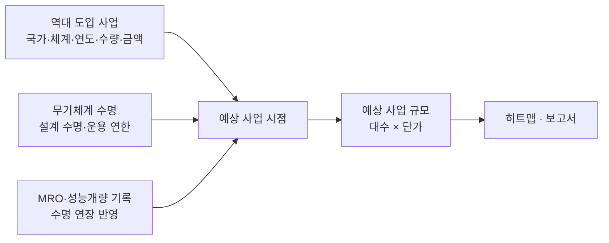
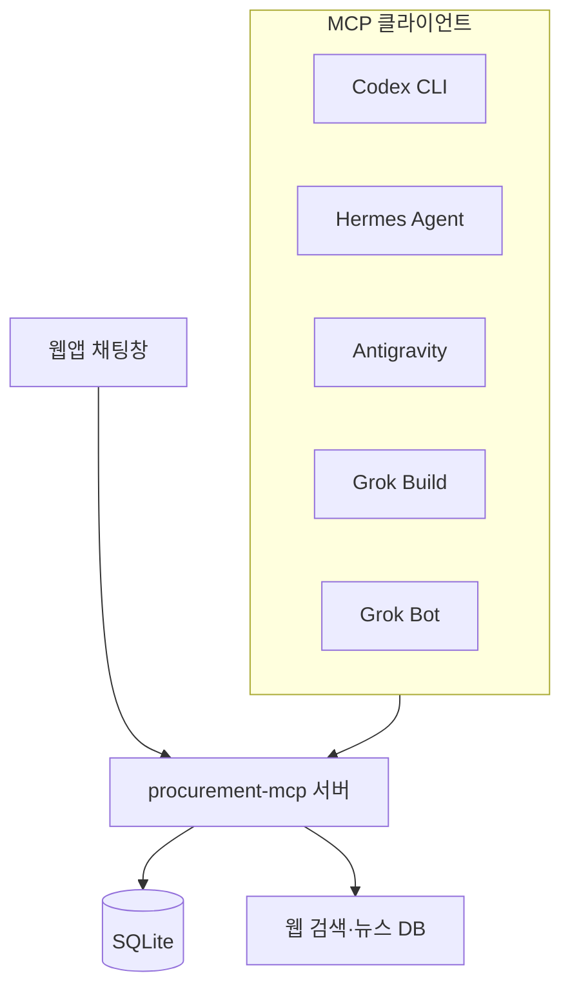

# 무기조달사업예상 · Global Procurement Radar

> 과제: 한화그룹 '글로벌 트렌드 레이더' 구축 (ASSIGNMENT 02 / 05). 과제 안내는 `origin` 브랜치를 보세요.
> **방산** 분야 아이디어 기획안입니다. 구현본은 이 저장소(`procurement-radar`)이며, 아래 내용은 구현에 맞춰 일부 수정했습니다(지도 모드, 전체 화면 지구본, 하단 오버레이 채팅, Cloudflare용 스택).

전 세계 주요 국가가 **언제, 어떤 무기를, 얼마나 큰 규모로 새로 사게 될지** 지구본 위에 히트맵으로 보여 주는 서비스입니다.
과거 대규모 수주 실적과 무기체계 수명, 정비(MRO) 기록을 바탕으로 다음 교체 사업 시점과 규모를 예측합니다.
아래 채팅창에서 AI 에이전트에게 국가별 조사 보고서를 맡길 수 있습니다.

---

## 1. 화면 구성

```
┌──────────────────────────────────────────────┐
│ 무기조달사업예상 [일반][자주포][장갑차][대공미사일][다연장로켓][호위함][재래식 잠수함] [지도 모드] │
│                                              │
│        🌍 화면 전체 = 3D 지구본 (또는 2D 세계지도)        │
│          (드래그 회전 · 휠 확대 · 히트맵)          │
│                                              │
│ 범례                                          │
│            ┌──── 💬 채팅 (위로 펼쳐짐) ────┐        │
│            └──────── 메시지 입력 ────────┘        │
└──────────────────────────────────────────────┘
```

- 지구본이 화면 전체를 채웁니다. 채팅은 화면 아래쪽에 겹쳐 뜨는 작은 입력창이며, 누르면 위로 펼쳐져 대화가 보입니다.
- 위쪽 버튼 7개로 모드를 바꿉니다.
  - **일반**: 히트맵이 없는 기본 지구본
  - **자주포 · 장갑차 · 대공미사일 · 다연장로켓 · 호위함 · 재래식 잠수함**: 해당 무기체계의 예상 사업 히트맵
- **지도 모드** 버튼으로 3D 지구본 ↔ 2D 평면 세계지도(정거원통도법)를 바꿉니다. 지구본이 펼쳐지듯 부드럽게 바뀌고, 히트맵은 두 모드 모두에서 보입니다.
- 지구본에서 나라를 누르면 그 나라에 카메라가 맞춰지고 채팅창 위에 "○○ 보고서" 버튼이 제안됩니다.

## 2. 지구본 (Three.js)

| 항목 | 구현 방법 |
|---|---|
| 지구본 | 순수 Three.js 셰이더 메시(경위도 → 구면/평면 변환), `OrbitControls`로 드래그 회전과 휠 확대 |
| 국가 경계 | Natural Earth GeoJSON → 구면 좌표 변환, 국가별 폴리곤 메시 |
| 히트맵 | 국가 폴리곤 색칠(choropleth) + 사업 규모에 비례한 막대(spike) 또는 발광 점 |
| 마우스 오버 | 광선-구/평면 교차 → 경위도 → 국가 폴리곤 포함 판정으로 툴팁 표시 |
| 지도 모드 | 같은 셰이더에서 구 → 평면 펼침(morph) 1.3초 |
| 전환 효과 | 모드를 바꿀 때 색이 0.5초 동안 부드럽게 바뀜 |

3D ↔ 2D 펼침 연출을 위해 `three-globe` 대신 순수 Three.js로 구현했습니다.

### 히트맵 읽는 법

- **색 = 임박도**. 예상 사업 시작까지 남은 기간입니다.
  - 🔴 빨강: 2년 이내
  - 🟠 주황: 3~5년
  - 🟡 노랑: 6~10년
  - 🔵 파랑: 10년 이후
  - ⚪ 회색: 데이터 부족
- **진하기 또는 막대 높이 = 사업 규모**. 예상 금액(억 원)의 로그 스케일입니다.
- 한눈에 "빨갛고 높은 곳"이 곧 열릴 큰 시장입니다.

### 툴팁 (커서를 올렸을 때)

```
🇵🇱 폴란드 · 자주포                 임박도 🔴 높음
현재 주력: ○○ (도입 19xx년, ○○대)
설계 수명: 약 ○○년 → 교체 예상 20xx~20xx년
최근 MRO: 20xx년 성능개량 (수명 +○년 반영)
예상 사업: ○○~○○대 · 약 ○○억~○○억 원
신뢰도: 중 (근거 3건)   [보고서 만들기]
```

※ 위 툴팁은 화면 예시이며 숫자는 실제 데이터가 아닙니다.

## 3. 예측 방법

무기는 정해진 수명이 다가오면 교체나 성능개량 사업이 열린다는 점을 이용합니다.



1. **예상 교체 시점**
   - 기본식: `교체 시점 = 도입 연도 + 설계 수명 + MRO로 늘어난 수명`
   - 여러 차례 나눠 도입했다면 도입 단위(배치)마다 따로 계산합니다.
2. **임박도**
   - `남은 기간 = 교체 시점 − 올해`
   - 노후 장비 비율이 높을수록, 최근 국방비 증가나 언론 보도 같은 신호가 있을수록 점수를 올립니다.
3. **사업 규모**
   - `예상 대수 = 현재 보유 대수 × 교체 비율`. 교체 비율은 그 나라의 과거 교체 사업에서 구합니다.
   - `예상 금액 = 예상 대수 × 최근 비슷한 사업의 대당 단가`
   - 결과는 하나의 숫자가 아니라 **범위(최소~최대)**로 냅니다.
4. **신뢰도**
   - 근거 자료의 수, 자료의 최신성, 출처의 신뢰도로 상·중·하를 매깁니다.
5. **검증**
   - 과거 시점으로 되돌려 실제로 열린 사업을 맞히는지 확인합니다(백테스트).
   - 예: 2015년 자료만으로 2016~2025년 사업을 예측해 비교합니다.

## 4. 데이터

| 구분 | 후보 출처 |
|---|---|
| 역대 도입·수출 사업 | SIPRI Arms Transfers Database, UN 재래식무기 등록제도, 각국 국방 조달기관 발표(한국 방위사업청, 미국 DSCA 판매 승인 공지 등) |
| 보유 현황 | 각국 국방백서, 공개 연감 자료 |
| 수명·MRO | 제조사 보도자료, 방산 전문 매체, 정부 계약 공고 |
| 최신 신호 | `방산` 브랜치의 **글로벌 방산 동향 검색**이 모은 뉴스 (재사용) |
| 환율·국방비 | 공개 환율 데이터, 각국 국방예산 |

### 저장 구조 (현재: `data/seed.json`, 나중에: Cloudflare D1 `db/schema.sql`)

- `programs`: 국가, 무기체계 종류, 모델, 계약 연도, 수량, 금액, 출처 URL
- `inventory`: 국가, 모델, 보유 대수, 도입 연도
- `lifespan`: 모델, 설계 수명, 출처
- `mro_events`: 국가, 모델, 연도, 내용, 늘어난 수명
- `forecasts`: 국가, 무기체계, 예상 시작 연도 범위, 대수 범위, 금액 범위, 신뢰도, 근거 목록
- 모든 숫자에 **출처 URL과 수집 날짜**를 함께 남깁니다. 출처 없는 숫자는 히트맵에 회색으로 표시합니다.

## 5. 채팅창과 MCP 서버

채팅창 뒤에는 자체 **MCP 서버**를 둡니다. MCP는 AI 에이전트가 외부 도구를 호출하는 표준 방식입니다.
그래서 같은 도구를 웹앱 채팅창은 물론 여러 AI 에이전트에서도 그대로 쓸 수 있습니다.



### MCP 도구

| 도구 | 하는 일 |
|---|---|
| `search_programs(country, system)` | 역대 도입 사업 조회 (DB → 없으면 웹 조사 후 저장) |
| `get_lifespan(model)` | 무기체계 설계 수명과 운용 연한 검색 |
| `search_mro(country, model)` | 정비·성능개량·수명연장 기록 검색 |
| `get_inventory(country, system)` | 현재 보유 대수와 도입 연도 |
| `forecast(country, system)` | 3장 방법으로 예상 시점·대수·금액 계산 |
| `write_report(country, system)` | 위 결과를 묶어 보고서(Markdown/PDF) 작성 |
| `update_heatmap(system)` | 새 예측을 지구본에 반영 |

### 에이전트 역할 분담 (안)

| 에이전트 | 맡을 일 |
|---|---|
| Codex CLI | 보고서 요약과 정리 |
| Hermes Agent | 국가별 사업 이력 장시간 조사, 반복 작업 |
| Antigravity | 웹 브라우징이 필요한 조달 공고 수집 |
| Grok Build / Grok Bot | 최신 뉴스·X 동향 확인, 결과 교차 검증 |

각 에이전트가 MCP를 어떤 방식으로 지원하는지는 구현할 때 하나씩 확인합니다.
웹앱 채팅창 기본 모델은 지금처럼 Gemma 4를 씁니다.

### 채팅 예시

> 사용자: 폴란드 자주포 다음 사업 예측해줘
> 챗봇: `search_programs` → `get_lifespan` → `search_mro` → `forecast` 순서로 도구를 실행하고, 지구본을 폴란드로 돌린 뒤 보고서를 띄웁니다.

### 보고서 양식 (1~2쪽)

1. 요약: 예상 시기, 대수, 금액 범위, 신뢰도
2. 현재 보유 장비와 도입 이력
3. 수명과 MRO 이력
4. 예측 근거와 계산 과정
5. 경쟁 구도와 한화 제품의 기회 (예: K9, 천무, 레드백 등 해당 체계)
6. 출처 목록

## 6. 기술 스택

- **프론트엔드**: Vite + TypeScript + Three.js (정적 파일 → Cloudflare Pages)
- **백엔드**: Hono (TypeScript) — Cloudflare Pages Functions, 로컬은 Vite 개발 서버 또는 Node
- **데이터**: 정적 JSON(`data/seed.json`), 나중에 D1(`db/schema.sql`)
- **MCP 서버**: TypeScript 공식 MCP SDK, stdio와 Streamable HTTP 지원
- **AI**: 채팅은 Gemma 4 (`gemma-4-26b-a4b-it`, Google AI Studio generateContent + functionDeclarations), 보고서는 공용 모듈에서 생성

## 7. 진행 계획

| 단계 | 내용 | 결과물 |
|---|---|---|
| 1 | 지구본과 모드 버튼 7개, 툴팁 (예시 데이터) | 돌아가는 지구본 화면 |
| 2 | 데이터 수집 스키마와 주요 10개국 시드 데이터 | SQLite DB |
| 3 | 예측 계산과 백테스트 | 히트맵 실데이터 반영 |
| 4 | MCP 서버와 도구 7개 | 에이전트 연결 |
| 5 | 채팅창과 보고서 생성 | 국가별 보고서 |

## 8. 주의할 점

- 공개 자료만 씁니다. 보유 대수나 계약 금액은 나라마다 공개 정도가 달라 빈칸이 생깁니다.
- 예측은 범위와 신뢰도로 보여 주고, 확정된 사실처럼 표시하지 않습니다.
- AI가 조사한 숫자는 출처 URL이 있을 때만 DB에 저장합니다.
