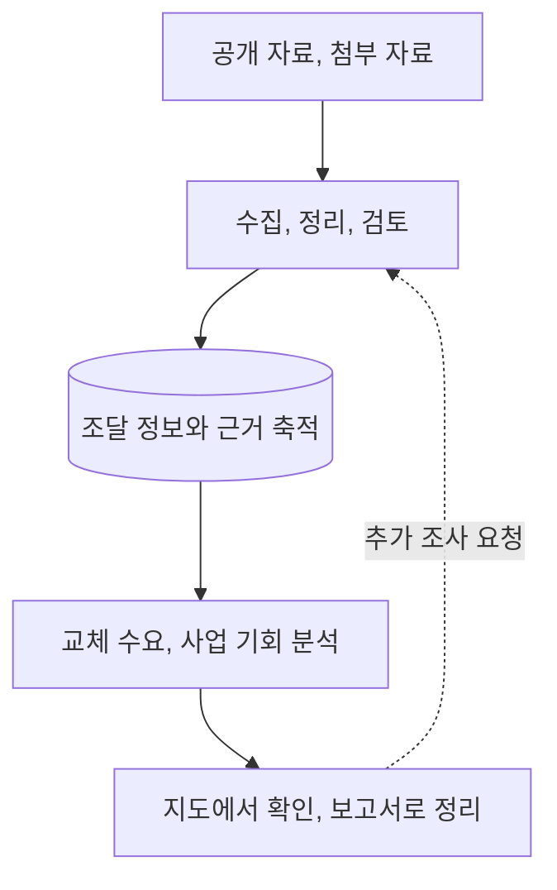

# 무기조달사업예상 ,  Global Procurement Radar

**공개 자료를 바탕으로 국가별 무기 교체 수요를 살펴보고, 조사에서 보고서 작성까지 이어가는 프로그램**

갱신일: 2026-10-21

## 1. 어떤 프로젝트인가요?

‘무기조달사업예상’은 각국이 어떤 무기를 보유하고 있으며, 언제 어느 정도의 규모로 교체할 가능성이 있는지 살펴보는 앱입니다.

 우리 파트의 ‘글로벌 트렌드 레이더’ 과제의 방산 분야 분석 도구로 출발했습니다. 사용자가 관심 국가와 장비를 찾고, 공개 자료를 조사해 새로운 사업 인사이트를 얻는 것이 목적입니다. 실제 사업장에서 적용한다면 각 계열사의 데이터를 DB에 넣는다면 더 정확한 인사이트를 얻을 수 있을 것입니다.

## 2. 무엇을 할 수 있나요?

| 핵심 기능 | 사용자가 하는 일 | 얻을 수 있는 정보 |
| --- | --- | --- |
| 지도 | 지구본이나 평면 지도에서 국가와 장비 종류를 선택합니다. | 현재 주력 장비, 교체 예상 시기, 예상 수량과 사업 금액, 신뢰도와 출처를 확인합니다. |
| 채팅창(자료 조사) | 궁금한 내용을 질문하고, 필요한 자료를 첨부해 검토를 요청합니다. | 기존 자료와 새로 찾은 내용을 비교하고, 근거가 있는 내용을 반영해 분석을 갱신합니다. |
| 채팅창(보고서 작성) | 국가별 분석이나 목적에 맞는 문서 작성을 요청합니다. | 채팅에서 국가 보고서를 확인하거나, 문서 작성 도구를 통해 워드 또는 파워포인트 파일로 정리합니다. |

현재 다루는 장비 종류는 **자주포, IFV(보병전투차량), 대공미사일, 다연장로켓, 호위함, 재래식 잠수함**입니다.

## 3. 자료는 어떤 과정을 거쳐 결과가 되나요?

공개 자료와 사용자 첨부 자료를 수집, 검토해 근거와 함께 쌓아 두고, 이를 분석해 지도와 보고서에 활용합니다. 사용자는 저장된 자료로 현황을 바로 살펴보고, 부족하거나 오래된 내용은 추가 조사를 요청해 보완할 수 있습니다.

